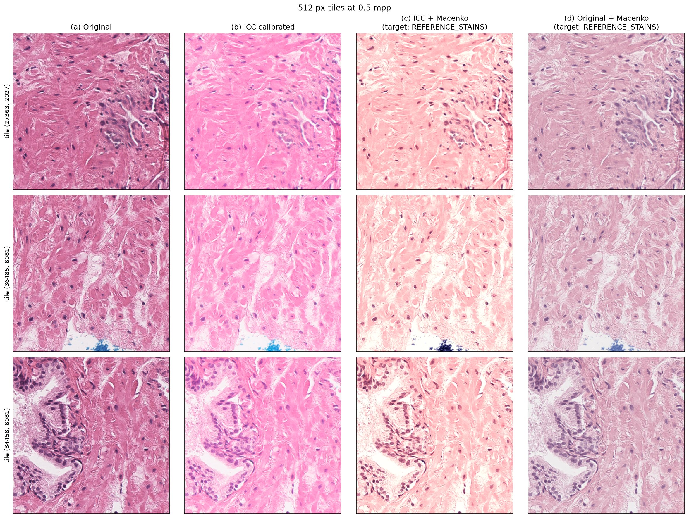
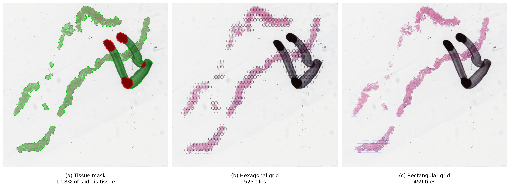
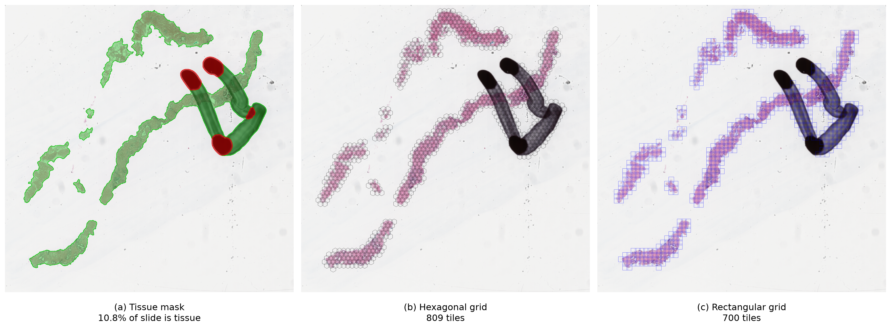

# patchology

<p align="center">
  
</p>

Whole slide image (WSI) tiling: tissue detection, artifact removal and square
or hexagonal tile grids, on top of OpenSlide or FastSlide. 

Many excellent tools already tile WSIs, but most are part of larger frameworks that are heavy to install and hard to navigate when all you need is tiling. patchology is a lightweight, standalone library focused on two things: **fast tiling** and **broad WSI format support**. 

> [!WARNING]
> For research use only. patchology is not a medical device and is not
> validated for clinical diagnosis.

## Install

patchology is not on PyPI yet; install it from a clone (Python 3.12+). The
OpenSlide backend is always installed (its binaries come with `openslide-bin`,
so no system package is needed); the `fastslide` extra adds the FastSlide
backend.

```bash
git clone https://github.com/twpkevin06222/patchology.git
cd patchology

pip install -e .                # OpenSlide backend
pip install -e ".[fastslide]"   # OpenSlide + FastSlide backends
```

`-e` installs in editable mode, so a `git pull` takes effect without
reinstalling.

### Patched OpenSlide (optional)

The standard `openslide-bin` from PyPI works for most formats. For PreciPoint
VMIC (`.vmic`) support and fixes for Ventana BIF and DICOM, build the patched
OpenSlide from the `dev` branch of
[twpkevin06222/openslide](https://github.com/twpkevin06222/openslide) and install
its wheel over the standard one (Linux; needs the build dependencies listed in
that repo):

```bash
git clone -b dev https://github.com/twpkevin06222/openslide
cd openslide/packaging
./build-wheel.sh
pip install --force-reinstall wheelhouse/openslide_bin-*.whl
```

## Quick start

```python
from patchology import ArtifactConfig, TilingConfig, TilingPipeline, open_slide

pipeline = TilingPipeline(
    tiling=TilingConfig(tile_size=224, tile_mpp=0.5, tile_overlap=0.2, grid="hex"),
    artifacts=ArtifactConfig(pen=True, blur=True),
)
with open_slide("slide.svs", backend="fastslide") as slide:
    result = pipeline.run(slide)
    result.save("out/slide")  # tiles.csv, metadata.json, tissue_mask.png, overlay.png
    for (x, y), tile in result.iter_tiles(slide):
        ...  # tile: (224, 224, 3) uint8 RGB
```

Or as a generator that owns the slide and exposes its properties and masks:

```python
from patchology import ColorConfig, TileGenerator

with TileGenerator("slide.svs", color=ColorConfig(stain_normalization="macenko")) as gen:
    gen.properties, gen.dimensions, gen.mpp, gen.icc_profile  # no tiling needed
    gen.tissue_mask, gen.artifact_mask, gen.coords, gen.source_stains  # computed in __init__
    for (x, y), tile in gen:  # ICC -> tissue -> artifacts -> tiles -> stain norm
        ...
```

ROI tiling: pass `roi=` a GeoJSON file (e.g. a QuPath export, level-0 pixel
coordinates) or a folder holding one GeoJSON whose name contains the slide
name. Only tissue inside the ROI is tiled. A file whose name does not contain
the slide name (whole token, so `sample` does not match `sample-2`) is
refused unless `check_roi_name=False`. `roi_exclude_classes={"class01"}` leaves
out objects of those annotation classes (QuPath classification names), e.g. to
tile only class02 and class03 from a segmentation annotation file.

```python
with TileGenerator("sample.svs", roi="sample.svs_roi_annotations.geojson") as gen:
    for (x, y), tile in gen:
        ...
```

Segmentation tiles: `SegmentationTileGenerator` takes a GeoJSON ground truth
and yields `((x, y), tile, mask)`, with `mask` a `(tile_size, tile_size)` uint8
array aligned with the tile. With `class_map` (annotation class name to label,
with integer larger than 0 [default background label value]) each object is drawn with its class's label and objects of unmapped
classes are ignored; without it the mask is 0/1. A tile is kept if at least
`object_mask_overlap` (e.g. 0.2 = 20%) of it is ground truth; 0 keeps every
tissue tile, including empty masks. All `TileGenerator` options (ICC, stain
normalisation, `roi=`) apply.

```python
from patchology import SegmentationTileGenerator

with SegmentationTileGenerator(
    "sample.svs",
    "sample.svs_annotations.geojson",
    object_mask_overlap=0.2,
    class_map={"class01": 1, "class02": 2, "class03": 3},
) as gen:
    for (x, y), tile, mask in gen:
        ...
```

GeoJSON format: ROI and ground-truth files are QuPath-style GeoJSON with
coordinates in level-0 (full resolution) pixels. See
[`src/patchology/references/sample.svs_annotations.geojson`](src/patchology/references/sample.svs_annotations.geojson)
for a complete example. A `FeatureCollection` (a single `Feature`, a list of
features or a bare geometry also work) of `Polygon` / `MultiPolygon` features;
the class is read from `properties.classification.name`, and other geometry
types (points, lines) are skipped with a warning:

```json
{
  "type": "FeatureCollection",
  "features": [
    {
      "type": "Feature",
      "geometry": {
        "type": "Polygon",
        "coordinates": [[[22575, 31840], [22575, 31842], "...", [22575, 31840]]]
      },
      "properties": {
        "objectType": "annotation",
        "classification": {"name": "class02", "color": [37, 46, 201]}
      }
    }
  ]
}
```

The first ring of a polygon is its outline and any further rings are holes.

PyTorch: a generator is a map-style dataset (`len`, `gen[i]`), so wrap it in a
`torch.utils.data.Dataset` and use any `num_workers`; each worker reopens the
slide, and tiling runs once in the main process. Read tiles with
`gen.get_tile(i)` (`((x, y), tile)`, plus `mask` for segmentation),
`gen.get_tile_at(x, y)` (any level-0 coordinate) and `gen.index_of(x, y)`.

```python
class Tiles(torch.utils.data.Dataset):
    def __init__(self, gen):
        self.gen = gen

    def __len__(self):
        return len(self.gen)

    def __getitem__(self, i):
        (x, y), tile = self.gen[i]
        return torch.from_numpy(tile).permute(2, 0, 1), torch.tensor([x, y])


loader = DataLoader(Tiles(TileGenerator("slide.svs")), batch_size=32, num_workers=4)
```

Export tiles to QuPath: `tiles_to_geojson(gen, "tiles.geojson", color=(0, 0, 0))`
writes each tile as a level-0 bounding box (black by default); drag the file onto
the slide in QuPath to view it.

Or in one call: `tile_slide("slide.svs", backend="openslide", tiling=TilingConfig(...))`.

## Readers

`open_slide(path, backend="openslide" | "fastslide", fallback=True)` returns a
`SlideReader` with the same interface as `openslide.OpenSlide`: `dimensions`,
`level_count`, `level_dimensions`, `level_downsamples`, `properties` (with
`openslide.*` keys), `associated_images`, `read_region` (level-0 location,
RGBA result, transparent outside the slide), `get_thumbnail` and
`get_best_level_for_downsample`.

If the preferred backend is not installed or cannot read the file, the other
one is tried. FastSlide's own metadata is kept under `fastslide.*` keys.

Extra helpers: `mpp`, `bounds`, `read_region_rgb`, `read_region_scaled`
(arbitrary downsample from the nearest level) and `read_at_downsample`.

### Supported formats

As reported by the patched `openslide-bin` 4.0.0+vmic.1 (its built-in drivers;
see [Patched OpenSlide](#patched-openslide-optional)) and FastSlide 0.8.1
(`fastslide.get_supported_extensions()`). Only Aperio `.svs` has been
tested with patchology.

| Format | Extension | OpenSlide | FastSlide |
|---|---|:---:|:---:|
| Aperio | `.svs`, `.tif` | ✅ | ✅ |
| Hamamatsu NDPI | `.ndpi` | ✅ | ✅ |
| Hamamatsu VMS / VMU | `.vms`, `.vmu` | ✅ | ❌ |
| 3DHISTECH MIRAX | `.mrxs` | ✅ | ✅ |
| Ventana | `.bif` | ✅ (patched build only) | ✅ |
| DICOM WSI | `.dcm` | ✅ | listed, untested (here) ¹ |
| Philips TIFF | `.tiff` | ✅ | ? ² |
| Philips iSyntax | `.isyntax`, `.i2syntax` | ❌ | ✅ |
| PreciPoint VMIC | `.vmic` | ✅ (patched build only) | ❌ |
| Leica | `.scn` | ✅ | ❌ |
| Sakura | `.svslide` | ✅ | ❌ |
| Trestle | `.tif` | ✅ | ? ² |
| Zeiss | `.czi` | ❌ | ✅ |
| Olympus / Evident | `.vsi`, `.ets` | ❌ | ✅ |
| Akoya / PerkinElmer | `.qptiff` | ❌ | ✅ |
| OME-TIFF | `.ome.tif`, `.ome.tiff` | ❌ | ✅ |
| OME-Zarr / Zarr | `.ome.zarr`, `.zarr` | ❌ | ✅ |
| Generic tiled TIFF | `.tif`, `.tiff` | ✅ | ✅ |

¹ FastSlide lists `.dcm` among its extensions; DICOM support has not been
verified here, so prefer OpenSlide for DICOM. ² FastSlide accepts `.tif` /
`.tiff` files, but whether it understands these vendor layouts is not documented.

### Speed

Tiles are read concurrently: both backends release the GIL while decoding, so
`TileGenerator(num_threads=...)` scales almost linearly. The default is
`min(8, CPUs - 1)`, counting only the CPUs the process may use (container or
`taskset` limits), so one CPU is always left for the rest of the program. Tiles
still come out in order and at most `2 * num_threads` are held at once.
`TilingResult.iter_tiles` and `save_tiles` take the same `num_threads`
argument. FastSlide gets a 64 MB per-slide tile cache, as OpenSlide has by
default.

Override the default for every generator without changing code (an explicit
`num_threads=` still wins):

```bash
export PATCHOLOGY_NUM_THREADS=4
```

With a PyTorch `DataLoader`, the threads and the workers do not compete: the
DataLoader reads tiles through indexing (`gen[i]`), which reads one tile per
call and starts no threads, so parallelism comes only from `num_workers`. Set
`num_workers` to about CPUs - 1 there. Threads are used only when you iterate the
generator (`for tile in gen`) or call `save_tiles`. If you do that inside each
DataLoader worker (e.g. an `IterableDataset`), set `PATCHOLOGY_NUM_THREADS=1`
(or pass `num_threads=1`) so workers × threads does not exceed your CPUs.

Two H&E Aperio slides (names withheld), median of 3 runs, each in a fresh
process with the file already in the OS cache: open the slide, detect tissue and
build the tile grid, then read every 224 px tile at 0.5 µm/px with colour
processing off. Peak is the run's resident memory high-water mark. Intel Core
Ultra 7 265K (20 cores).

| Slide | Backend | Threads | Tiles | Open | Tissue + grid | Read all tiles | Tiles/s | Peak memory |
|---|---|---:|---:|---:|---:|---:|---:|---:|
| A (636 MB, 55775 × 55544) | OpenSlide | 1 | 1704 | 16 ms | 0.37 s | 6.21 s | 274 | 234 MB |
| A | OpenSlide | 8 | 1704 | 16 ms | 0.38 s | 0.86 s | 1971 | 234 MB |
| A | FastSlide | 1 | 1715 | 7 ms | 0.23 s | 3.47 s | 494 | 238 MB |
| A | FastSlide | 8 | 1715 | 8 ms | 0.23 s | **0.50 s** | **3460** | 238 MB |
| B (54 MB, 23904 × 27759) | OpenSlide | 1 | 2806 | 13 ms | 0.22 s | 8.69 s | 323 | 166 MB |
| B | OpenSlide | 8 | 2806 | 12 ms | 0.22 s | 2.51 s | 1118 | 259 MB |
| B | FastSlide | 1 | 2737 | 4 ms | 0.16 s | 7.53 s | 363 | 302 MB |
| B | FastSlide | 8 | 2737 | 4 ms | 0.16 s | **2.05 s** | **1337** | 317 MB |

FastSlide reads 1.1–1.8× faster than OpenSlide, and 8 threads read 3.5–7×
faster than one. Slide B is smaller and more compressed, so it gains less. With
ICC calibration and Macenko normalisation on, slide A runs at 177 (OpenSlide) and
248 (FastSlide) tiles/s on one thread and 1213 and 1735 tiles/s on eight. Tile
counts differ slightly between backends because each decodes the detection
thumbnail a little differently. Reproduce with
`uv run python -m patchology.utilities.benchmark_backends slide1.svs [slide2.svs ...]`.

## Pipeline

1. **Tissue detection** (`TissueConfig`): the slide is read at
   `thumbnail_mpp` (default 8 µm/px) and HSV saturation is thresholded
   (`triangle` by default; `otsu`, `otsu_gray` and `fixed` are available),
   then closed, with small fragments removed and small holes filled. All sizes
   are in microns.
2. **Custom mask**: pass `tissue_mask=` to `run()` (array, PIL image, `.npy`
   or image path, or `SlideMask`) to replace detection. The mask may be at any
   resolution and is assumed to cover the whole slide.
3. **Artifact removal** (`ArtifactConfig`): pen ink (blue, green, black; red
   is opt-in) is detected on the thumbnail. Blur detection (opt-in, slower)
   scores focus on 128 µm cells at `blur_mpp` as Laplacian variance relative
   to intensity variance, over stained pixels only. Artifacts are removed
   from custom masks too; set `pen=False` to keep a mask as is.
4. **Tiling** (`TilingConfig`): `tile_size` is in output pixels at
   `tile_mpp`. `tile_overlap` is the fraction by which neighbouring tiles
   overlap (default 0; 0.2 means 20%), so tiles are
   `tile_size * (1 - tile_overlap)` apart. `grid="hex"` places tile centres
   on a hexagonal lattice, so each tile has six neighbours at that distance.
   A tile is kept if at least `tissue_overlap` (default 0.1, i.e. 10%) of its
   area overlaps tissue. Coordinates are level-0 top-left corners.
5. **Colour** (`ColorConfig`): tiles read through `read_tile` / `iter_tiles`
   are first converted from the slide's embedded ICC profile to sRGB
   (`icc=True`, default; slides without a profile are unchanged), then
   optionally stain normalised with Macenko
   (`stain_normalization="macenko"`). The slide's stains are estimated once
   from `stain_sample_tiles` selected tiles and mapped to `stain_target`:
   the classic Macenko reference vectors (`REFERENCE_STAINS`) by default, or
   your own reference as an image path, PIL image, uint8 RGB array, or
   `Stains`.

```python
from patchology import ColorConfig, TilingPipeline

pipeline = TilingPipeline(color=ColorConfig(stain_normalization="macenko"))
pipeline = TilingPipeline(
    color=ColorConfig(stain_normalization="macenko", stain_target="my_reference.png")
)
```

## Colour calibration and stain normalisation

Scanners store pixels in their own colour space and record it as an embedded
ICC profile. ICC calibration (on by default) converts tiles to standard sRGB,
so they look as the scanner vendor intended and match across scanners. Stain
normalisation then maps the slide's hematoxylin and eosin colours onto a
target, which reduces staining differences between labs and batches. ICC runs
first, so stains are estimated on calibrated colours.


*Three 512 px tiles at 0.5 µm/px: (a) as stored, (b) after ICC calibration to
sRGB, (c) after ICC and Macenko normalisation to `REFERENCE_STAINS`.*

The classic `REFERENCE_STAINS` target gives a pale eosin (as in (c)); pass
your own reference tile, e.g. `stain_target="my_reference.png"`, to match your
data. Regenerate the figure with
`uv run --with matplotlib python -m patchology.utilities.plot_color slide.svs [reference.png]`.

## Visualization

All functions return a `PIL.Image` (shown inline in Jupyter; `.show()` or
`.save()` elsewhere). Tissue is drawn in green and artifacts in red. Tiles
from a square grid are drawn as blue boxes, and tiles from a hex grid as black
hexagons centred on each tile (`tile_shape=` and `tile_color=` override this).

```python
from patchology import visualize_result, visualize_slide

result.overlay()  # masks + tiles on the detection thumbnail
result.overlay(tiles=False)  # tissue mask only
result.overlay(tissue=False, artifacts=False)  # tile grid only
result.overlay(slide=slide, max_size=4096)  # sharper, re-read from the slide

# Any slide / mask / coordinates, e.g. reloaded from a saved run:
visualize_slide(
    slide,
    tissue_mask="out/tissue_mask.png",
    coords=coords,
    tile_size=level0_tile_size,
    max_size=2048,
)
```

`draw_mask` and `draw_tiles` are the numpy building blocks, for composing
your own figures.


*512×512 px tiles at 0.5 µm/px, `tile_overlap=0`, `tissue_overlap=0.1`.*


*Same slide with `tile_overlap=0.2`.*

## Development

```bash
uv sync --all-extras
uv run pytest
# Backend conformance tests against a real slide:
PATCHOLOGY_TEST_SLIDE=/path/to/slide.svs uv run pytest
```

## License

Apache License 2.0, see [LICENSE](LICENSE). OpenSlide (installed via
`openslide-bin`) is LGPL-2.1 and is used as a separate library.
